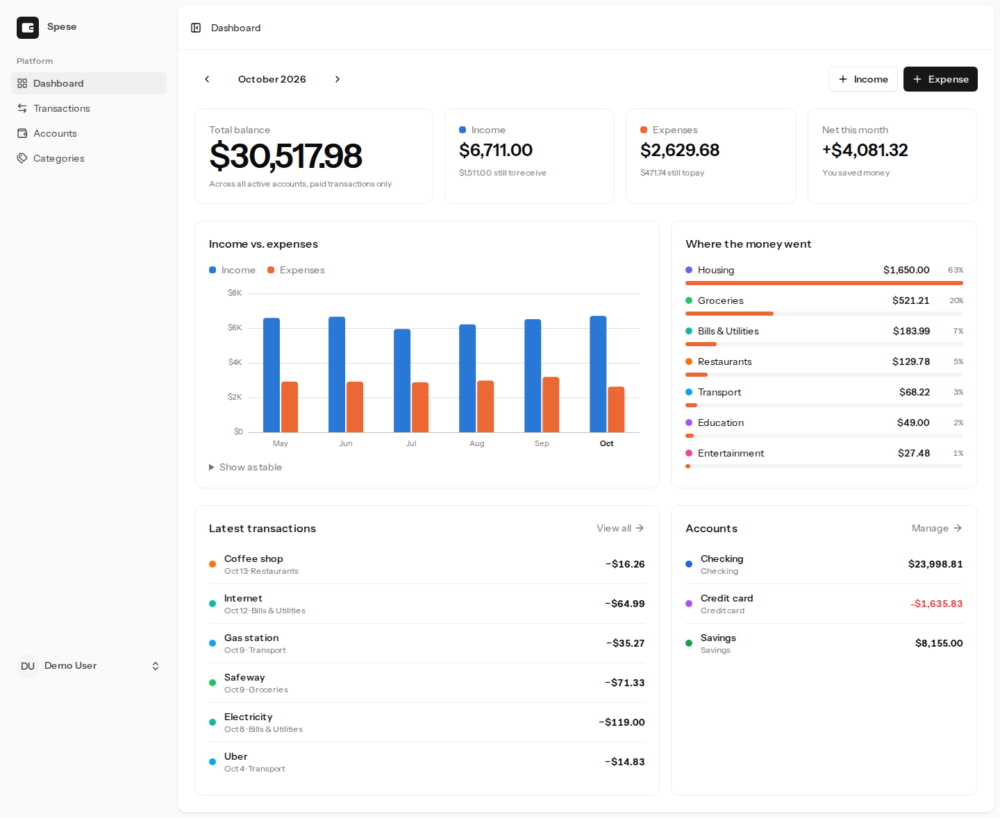
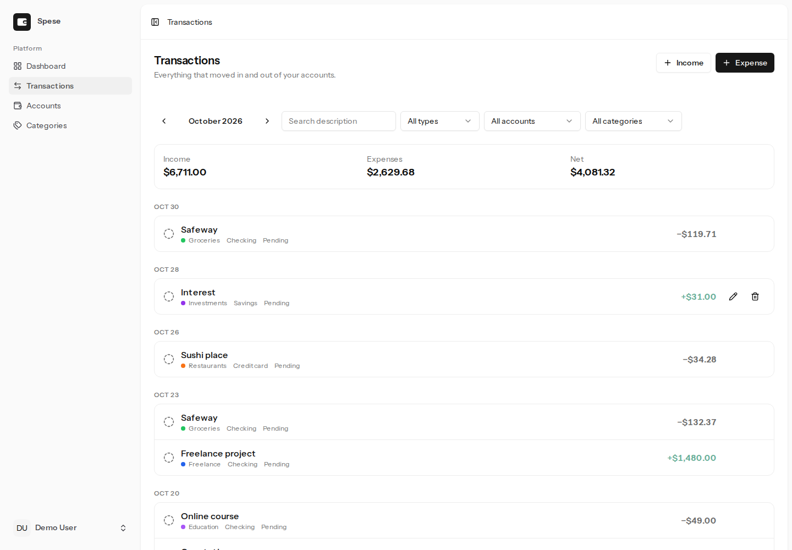
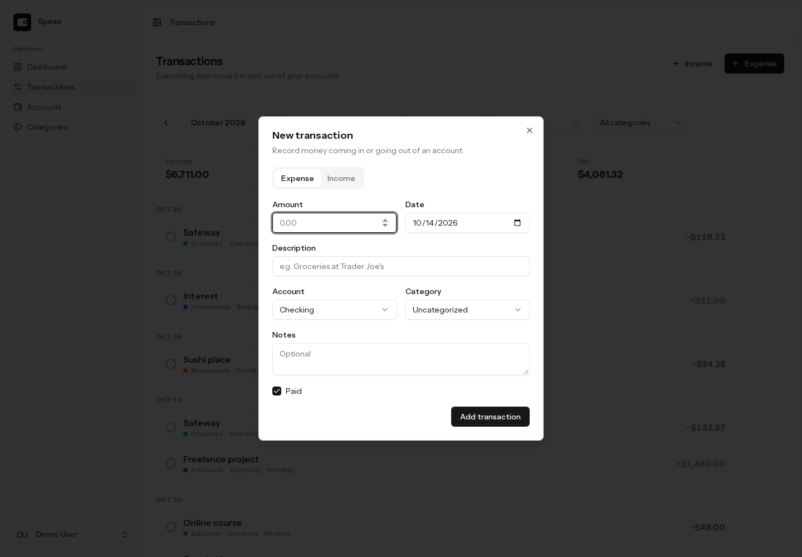
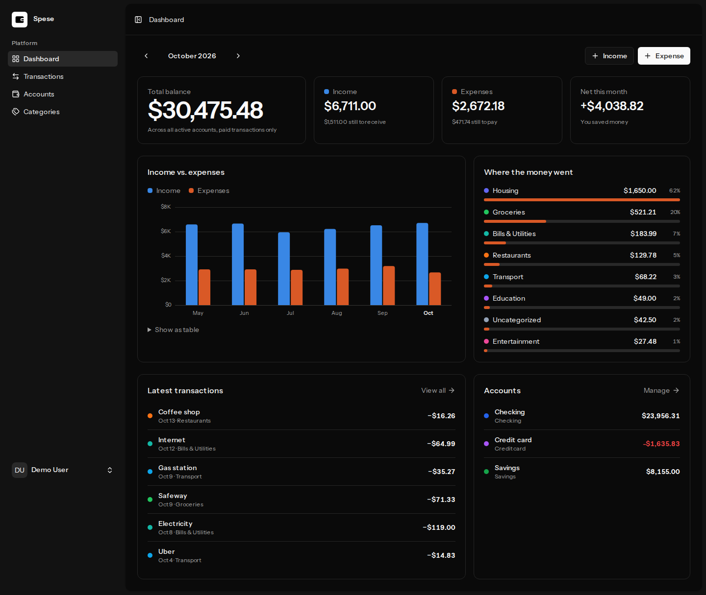
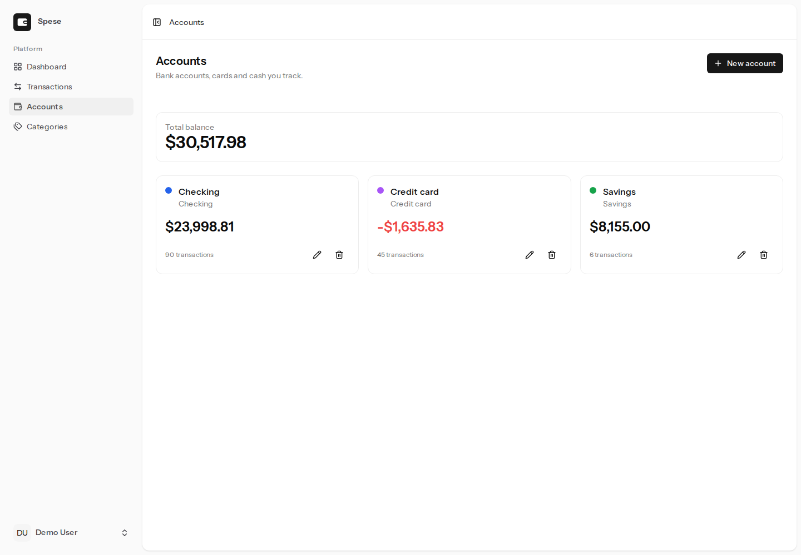

# Spese — personal finance tracker

Track accounts, income and expenses month by month, with a dashboard that shows where the money went.

**Stack:** Laravel 13 · Inertia 3 · Vue 3 + TypeScript · Tailwind 4 · Pest · PHPStan (level 7)



<table>
  <tr>
    <td></td>
    <td></td>
  </tr>
  <tr>
    <td></td>
    <td></td>
  </tr>
</table>

## Features
- Accounts (checking, savings, credit card, cash, investment) with live balances
- Income/expense transactions with categories, paid/pending status and notes
- Monthly dashboard: balance, income vs. expenses (6-month chart), spending by category
- Filters by type, account, category and text search
- Default categories created on sign-up; per-user authorization on every record
- Money stored as integer cents; light and dark mode; responsive

## Running locally
```bash
composer setup
php artisan migrate:fresh --seed   # demo user: demo@example.com / password
composer dev
```

## Quality
```bash
composer test   # Pint + PHPStan + Pest
```
